# Performance Analysis of Type-1 and Type-2 Hypervisors

> Empirical performance evaluation and architectural comparative analysis between bare-metal Type-1 (**Proxmox VE / KVM**) and hosted Type-2 (**VMware Workstation**) hypervisors evaluating CPU computational throughput and scheduling latency under identical guest environments.

[](#)
[](#)
[](#)
[](#)
[](LICENSE)
[](#)

---

## Overview

Virtualization provides the foundation for multi-tenant isolation, elastic resource provisioning, and scalable infrastructure in modern cloud computing. However, different virtualization architectures impose varying degrees of hardware abstraction overhead. 

This project provides an empirical performance analysis comparing two distinct virtualization paradigms:
- **Type-1 (Bare-Metal) Hypervisor:** **Proxmox Virtual Environment (PVE)** utilizing the Linux Kernel-based Virtual Machine (KVM) module running directly on physical server hardware.
- **Type-2 (Hosted) Hypervisor:** **VMware Workstation** executing as an application layer on top of a general-purpose host operating system.

Both hypervisor platforms were configured with standardized Ubuntu Linux virtual machines provisioned with identical resource constraints: **2 vCPUs, 2 GB RAM, and a 20 GB virtual disk**. Computational performance, event throughput, and execution latency were measured using the standardized **Sysbench CPU** prime-calculation benchmark ($20,000$ primes).

---

## Objectives

The primary engineering and experimental objectives of this project are:

1. **Deploy an Ubuntu Virtual Machine using Proxmox VE (Type-1 Hypervisor)** on dedicated host hardware.
2. **Deploy an Ubuntu Virtual Machine using VMware Workstation (Type-2 Hypervisor)** on the hosted environment.
3. **Configure comparable virtual hardware resources** across both virtualization platforms (2 vCPU, 2 GB RAM, 20 GB Disk).
4. **Verify CPU, memory, and disk configurations** inside both Ubuntu guests using native Linux auditing utilities (`lscpu`, `free -h`, `df -h`).
5. **Execute identical Sysbench CPU benchmark workloads** under identical parameter limits (`--cpu-max-prime=20000`).
6. **Record empirical benchmark metrics**, including total execution time, total completed events, event throughput (events/second), and detailed latency distributions.
7. **Conduct a comparative performance analysis** to evaluate the architectural overhead differences between bare-metal and hosted virtualization.

---

## Research Question

> **How does CPU benchmark performance differ between a Type-1 hypervisor environment and a Type-2 hypervisor environment when comparable virtual machine resources and identical workloads are used?**

---

## Virtualization Architecture

Virtualization hypervisors are classified according to where the hypervisor abstraction layer resides within the computing hierarchy:

### Type-1: Proxmox VE / KVM (Bare-Metal / Native)
In Type-1 virtualization, the hypervisor operates directly on the underlying physical server hardware without an intervening host operating system. Proxmox VE leverages the Linux Kernel-based Virtual Machine (KVM) kernel module, turning the Linux kernel itself into a bare-metal hypervisor. CPU instructions from the guest VM are dispatched directly to the physical CPU via hardware virtualization extensions (Intel VT-x / AMD-V), minimizing translation layers and context-switching overhead.

### Type-2: VMware Workstation (Hosted)
In Type-2 virtualization, the hypervisor executes as a user-level application on top of an existing host operating system. The guest virtual machine must interact with the virtual machine monitor (VMM), which in turn relies on the host OS kernel scheduler, memory management subsystems, and device drivers to access physical silicon. This introduces a two-tier abstraction boundary, resulting in increased scheduling latency and potential resource contention with host processes.

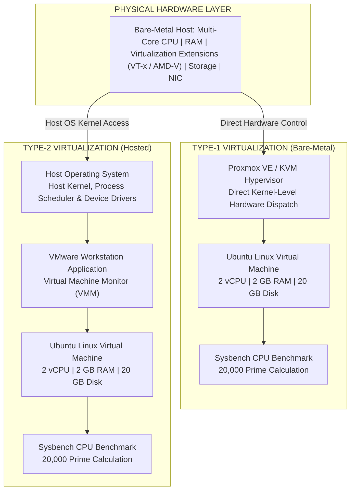

### Architectural Diagram

The diagram below provides a visual comparison of the architectural layers in both environments:

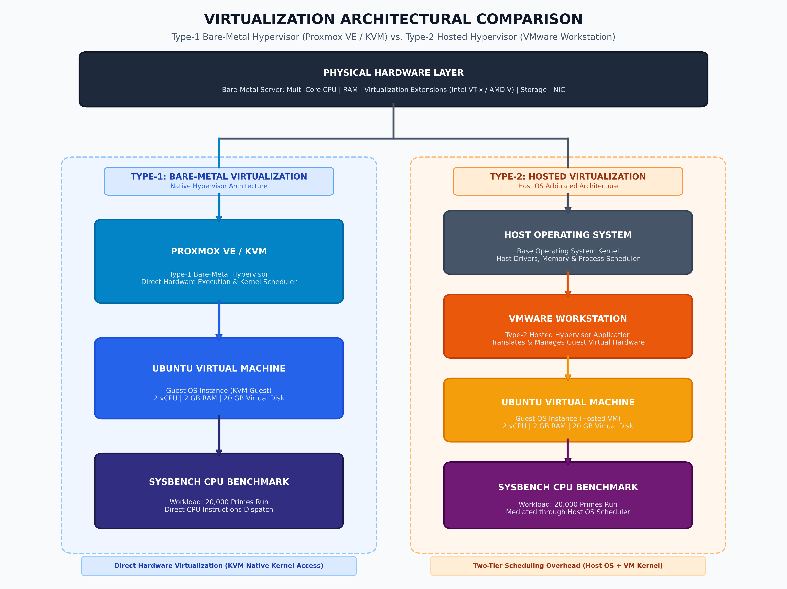

---

## Experimental Environment

To isolate the virtualization hypervisor layer as the sole independent variable, all virtual machine specifications were strictly standardized:

| Parameter | Type-1 Hypervisor | Type-2 Hypervisor | Verification / Audit Method |
| :--- | :--- | :--- | :--- |
| **Virtualization Platform** | Proxmox VE (PVE) | VMware Workstation | Web GUI / Desktop Console |
| **Virtualization Type** | Type-1 (Bare-Metal / KVM) | Type-2 (Hosted) | Architectural Classification |
| **Guest Operating System** | Ubuntu Linux 64-bit | Ubuntu Linux 64-bit | `cat /etc/os-release` |
| **Virtual CPUs (vCPU)** | 2 Cores | 2 Cores | `lscpu` |
| **Memory Allocation (RAM)** | 2.00 GB (2048 MB) | 2.00 GB (2048 MB) | `free -h` |
| **Virtual Disk Allocation** | 20.0 GB | 20.0 GB | `df -h /` |
| **Benchmark Suite** | Sysbench 1.0.20 | Sysbench 1.0.20 | `sysbench --version` |
| **Benchmark Test** | Sysbench CPU (LuaJIT) | Sysbench CPU (LuaJIT) | Standardized CLI Execution |
| **Computational Prime Limit** | 20,000 | 20,000 | `--cpu-max-prime=20000` |
| **Execution Window** | ~10.0 seconds | ~10.0 seconds | Default timed sample run |

> [!NOTE]
> Hardware allocations were verified within the guest operating system terminal sessions prior to initiating benchmark executions. Resource ballooning and non-essential guest services were kept quiescent.

---

## Benchmark Methodology

### Benchmark Execution Command
The identical CPU benchmark command was executed inside the Ubuntu terminal of both virtual machines:

```bash
sysbench cpu --cpu-max-prime=20000 run
```

### What Sysbench Measures
The Sysbench CPU benchmark evaluates processor performance by running a computationally intensive algorithm that calculates prime numbers through trial division up to a specified upper ceiling (`--cpu-max-prime=20000`).

- **Workload Event:** One benchmark event corresponds to a full verification pass verifying all primes up to $20,000$.
- **Throughput (Events per Second):** Represents the computational throughput achieved by the guest CPU, calculating how many prime-search sequences can be completed every second.
- **Latency Distribution:** Measures the elapsed execution time for individual calculation events (reporting minimum, average, maximum, and 95th percentile response times in milliseconds).

---

## Type-1 Results

Empirical results recorded from the **Proxmox VE (Type-1)** Ubuntu virtual machine benchmark execution:

```text
sysbench 1.0.20 (using system LuaJIT 2.1.0-beta3)

Running the test with following options:
Number of threads: 1
Initializing random number generator from current time


Prime numbers limit: 20000

Initializing worker threads...

Threads started!

CPU speed:
    events per second:  1453.98

General statistics:
    total time:                          10.0030s
    total number of events:              14548

Latency (ms):
         min:                                    0.57
         avg:                                    0.69
         max:                                    1.24
         95th percentile:                        0.74
         sum:                                 9994.30

Threads fairness:
    events (avg/stddev):           14548.0000/0.00
    execution time (avg/stddev):   9.9943/0.00
```

| Metric | Proxmox VE (Type-1) Measurement |
| :--- | :--- |
| **Total Execution Time** | `10.0030 s` |
| **Total Number of Events** | `14,548` |
| **Throughput (Events/sec)** | `1,453.98` |
| **Minimum Latency** | `0.57 ms` |
| **Average Latency** | `0.69 ms` |
| **95th Percentile Latency** | `0.74 ms` |
| **Maximum Latency** | `1.24 ms` |

---

## Type-2 Results

Empirical results recorded from the **VMware Workstation (Type-2)** Ubuntu virtual machine benchmark execution:

```text
sysbench 1.0.20 (using system LuaJIT 2.1.0-beta3)

Running the test with following options:
Number of threads: 1
Initializing random number generator from current time


Prime numbers limit: 20000

Initializing worker threads...

Threads started!

CPU speed:
    events per second:  1037.93

General statistics:
    total time:                          10.0002s
    total number of events:              10381

Latency (ms):
         min:                                    0.94
         avg:                                    0.96
         max:                                    3.30
         95th percentile:                        1.03
         sum:                                 9993.73

Threads fairness:
    events (avg/stddev):           10381.0000/0.00
    execution time (avg/stddev):   9.9937/0.00
```

| Metric | VMware Workstation (Type-2) Measurement |
| :--- | :--- |
| **Total Execution Time** | `10.0002 s` |
| **Total Number of Events** | `10,381` |
| **Throughput (Events/sec)** | `1,037.93` |
| **Minimum Latency** | `0.94 ms` |
| **Average Latency** | `0.96 ms` |
| **95th Percentile Latency** | `1.03 ms` |
| **Maximum Latency** | `3.30 ms` |

---

## Comparative Results

The table below summarizes the recorded experimental measurements from this experiment:

| Metric | Proxmox VE (Type-1) | VMware Workstation (Type-2) | Absolute Delta ($\Delta$) | Percentage Advantage |
| :--- | :---: | :---: | :---: | :---: |
| **Total Execution Time** | **10.0030 s** | **10.0002 s** | `+0.0028 s` | Equivalent duration |
| **Total Events** | **14,548** | **10,381** | `+4,167 events` | **+40.08%** (Proxmox higher) |
| **Events per Second (Throughput)** | **1,453.98** | **1,037.93** | `+416.05 eps` | **+40.08%** (Proxmox faster) |
| **Average Latency** | **0.69 ms** | **0.96 ms** | `-0.27 ms` | **28.13%** (Proxmox lower latency) |
| **Minimum Latency** | **0.57 ms** | **0.94 ms** | `-0.37 ms` | **39.36%** (Proxmox lower latency) |
| **95th Percentile Latency** | **0.74 ms** | **1.03 ms** | `-0.29 ms` | **28.16%** (Proxmox lower latency) |
| **Maximum Latency Spike** | **1.24 ms** | **3.30 ms** | `-2.06 ms` | **62.42%** (Proxmox lower tail jitter) |

> [!IMPORTANT]
> All figures above represent direct experimental measurements recorded during this laboratory experiment. They demonstrate the relative performance of these specific configurations and benchmark executions.

---

## Performance Visualization

### Comprehensive Performance Dashboard
The multi-panel dashboard below summarizes CPU throughput, total processed event count, average latency, and latency percentile distributions:

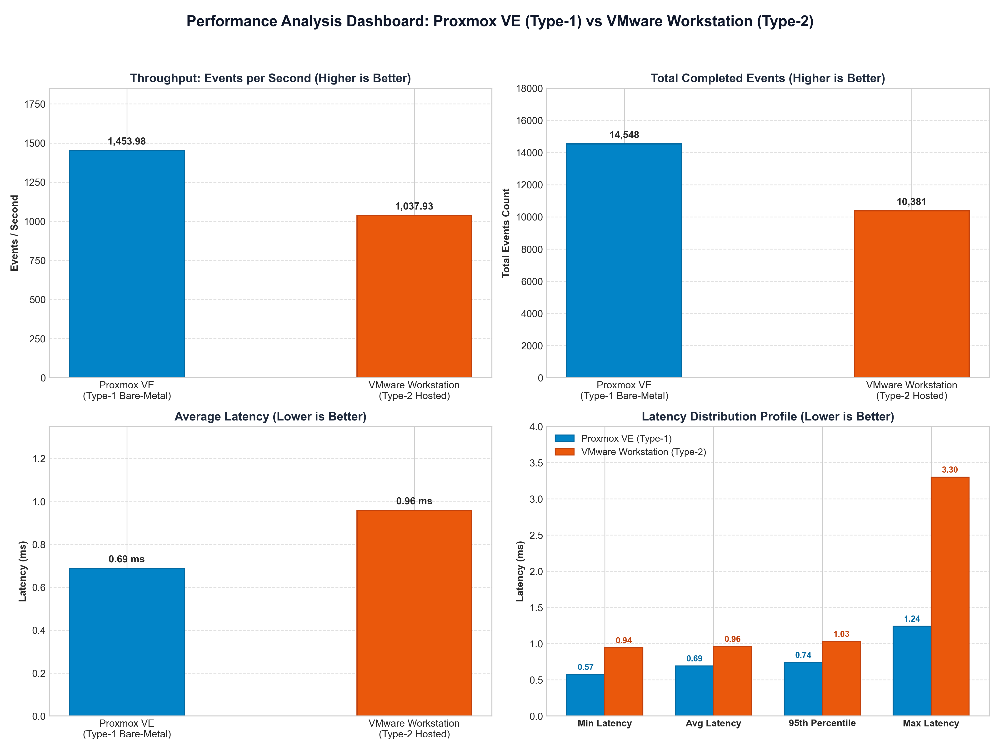

### Metric Comparison Charts

| Throughput Comparison (Events/sec) | Average Latency Comparison (ms) |
| :---: | :---: |
| 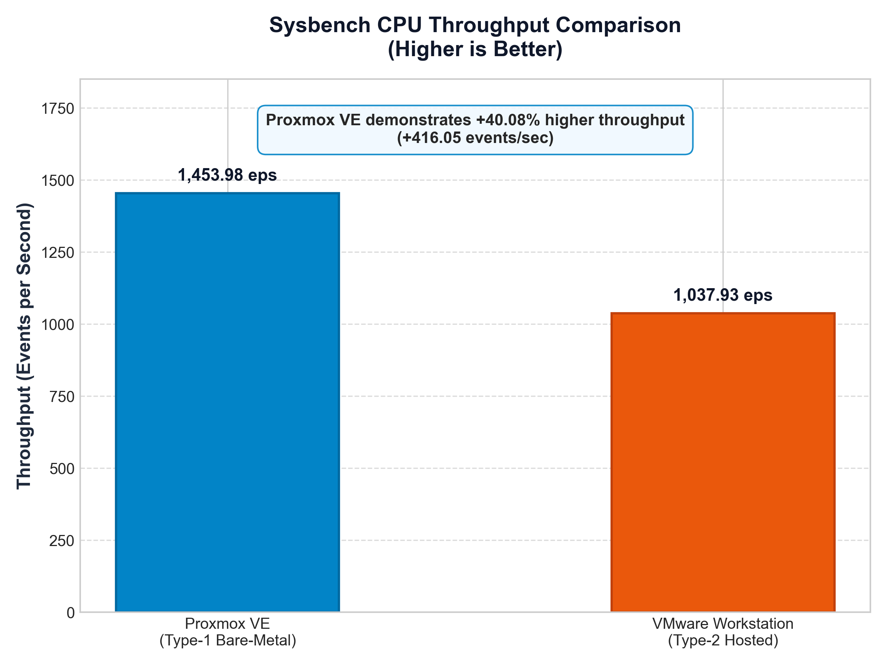 | 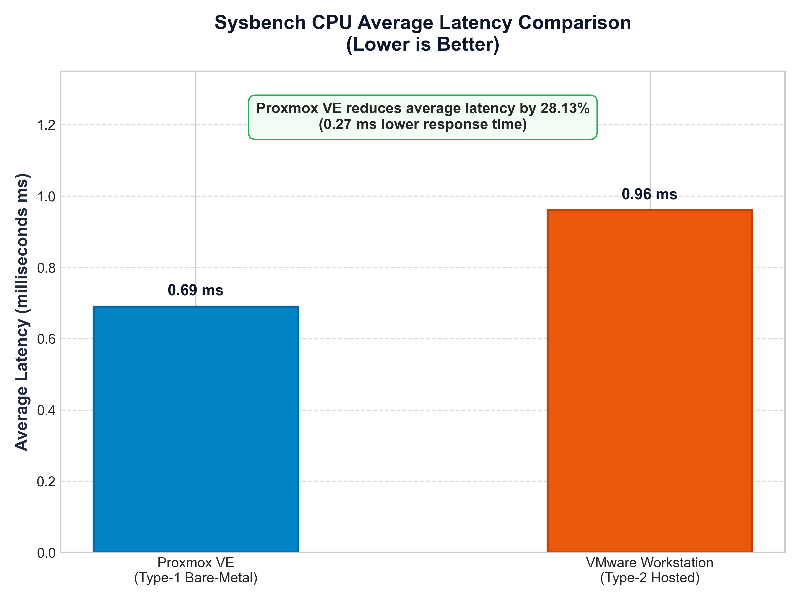 |
| *Higher is better — Proxmox delivers +40.08% higher throughput* | *Lower is better — Proxmox reduces latency by 28.13%* |

---

## Screenshots / Experimental Evidence

### Type-1 — Proxmox VE

| Screenshot | Description | Evidence Link |
| :--- | :--- | :--- |
| 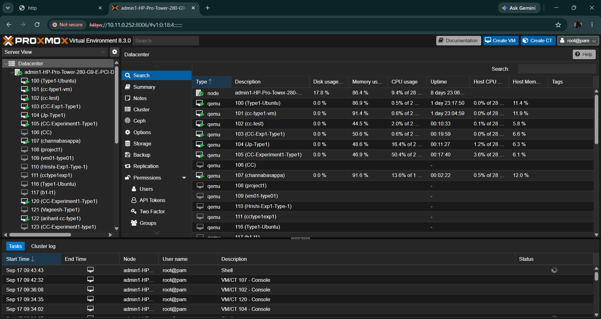 | **Proxmox VE Cluster Dashboard**<br/>Node health, memory, CPU, and cluster storage overview. | [`01-proxmox-dashboard.png`](docs/screenshots/type1-proxmox/01-proxmox-dashboard.png) |
| 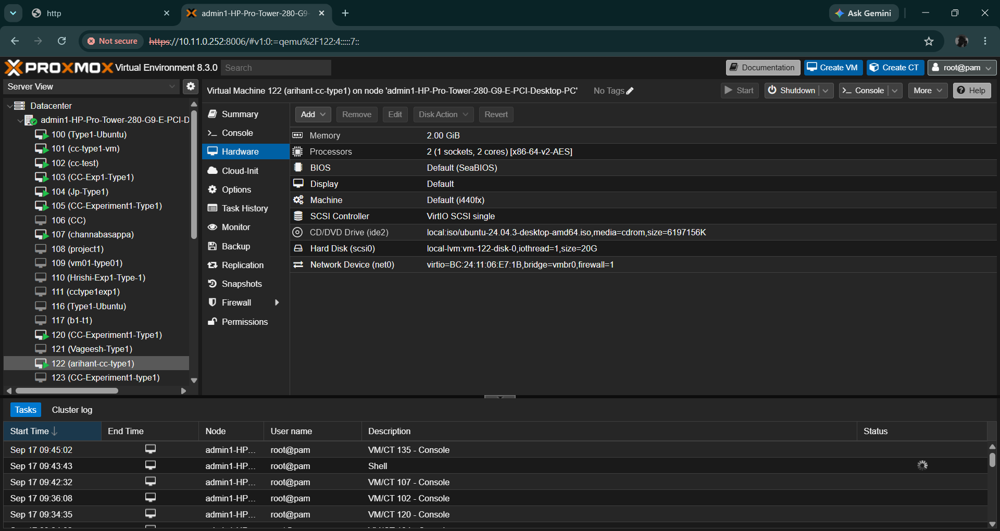 | **VM 1228 Configuration**<br/>2 vCPU, 2048 MB memory, SCSI virtual disk allocation. | [`02-proxmox-vm-configuration.png`](docs/screenshots/type1-proxmox/02-proxmox-vm-configuration.png) |
| 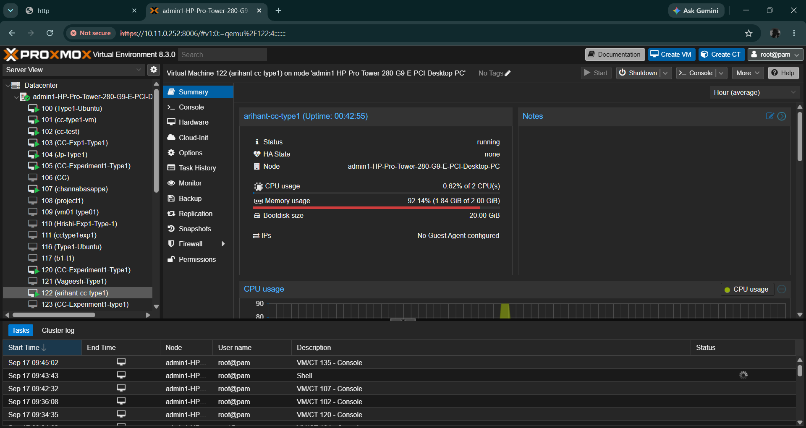 | **Proxmox VM Running State**<br/>Live active status verification in web manager. | [`03-proxmox-vm-running.png`](docs/screenshots/type1-proxmox/03-proxmox-vm-running.png) |
| 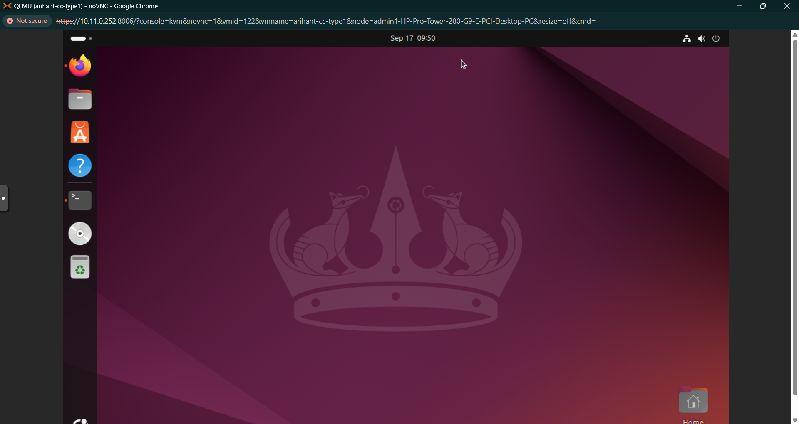 | **Ubuntu VM noVNC Console**<br/>Guest Linux console access via web browser. | [`04-proxmox-ubuntu-console.png`](docs/screenshots/type1-proxmox/04-proxmox-ubuntu-console.png) |
| 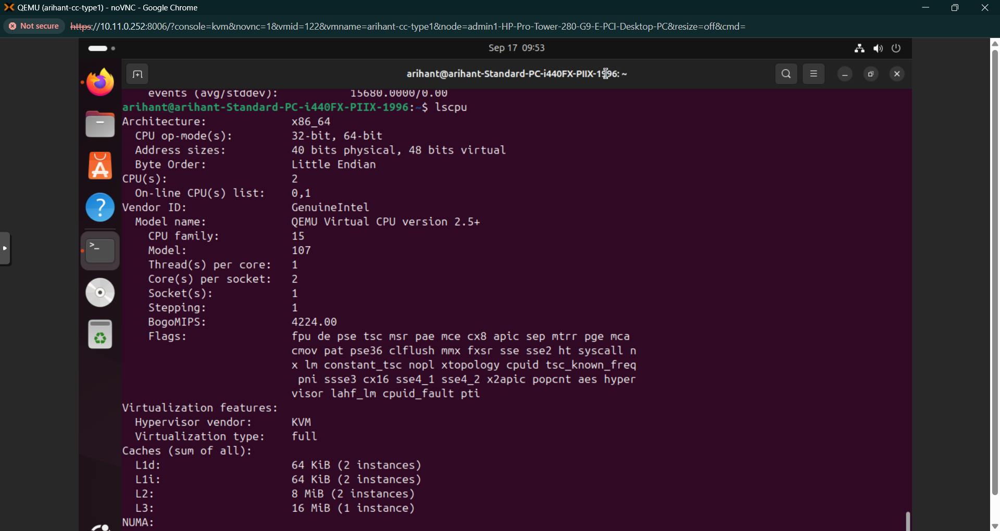 | **Guest System Configuration (Part 1)**<br/>Inside-guest terminal inspection of CPU architecture. | [`05-01-proxmox-system-configuration.png`](docs/screenshots/type1-proxmox/05-01-proxmox-system-configuration.png) |
| 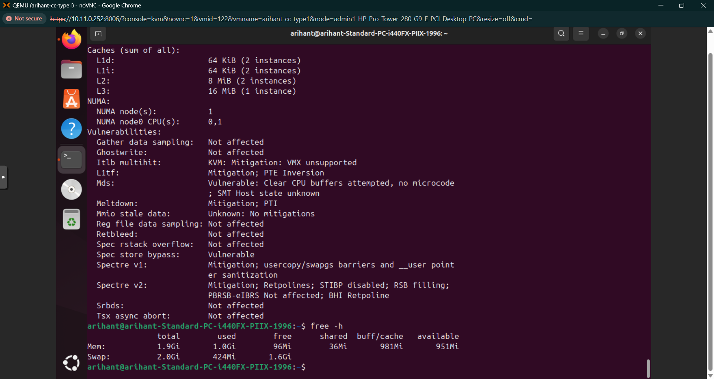 | **Guest System Configuration (Part 2)**<br/>Memory and filesystem allocation verification. | [`05-02-proxmox-system-configuration.png`](docs/screenshots/type1-proxmox/05-02-proxmox-system-configuration.png) |
| 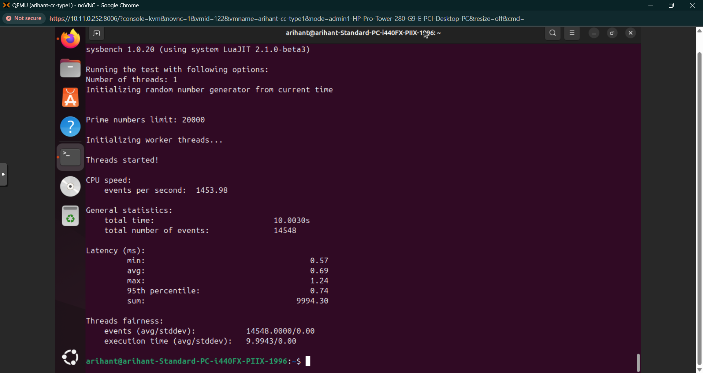 | **Sysbench CPU Benchmark Terminal Output**<br/>Actual recorded run: 1453.98 eps, 10.0030 s, 0.69 ms avg latency. | [`06-proxmox-sysbench-result.png`](docs/screenshots/type1-proxmox/06-proxmox-sysbench-result.png) |
| 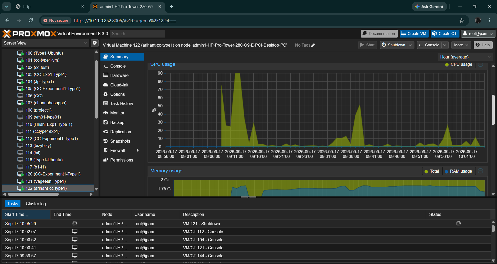 | **Host Resource Monitoring Graphs**<br/>Proxmox VE CPU and memory utilization graphs during execution. | [`07-01proxmox-resource-monitoring.png`](docs/screenshots/type1-proxmox/07-01proxmox-resource-monitoring.png) |

---

### Type-2 — VMware Workstation

| Screenshot | Description | Evidence Link |
| :--- | :--- | :--- |
| 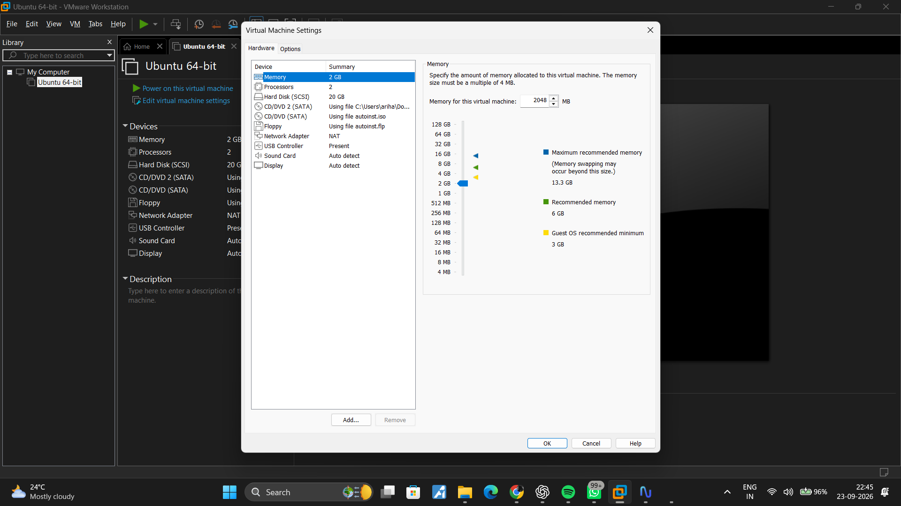 | **VMware Hardware Settings**<br/>2 Processors, 2 GB RAM, 20 GB hard disk specification. | [`01-vmware-vm-configuration.png`](docs/screenshots/type2-vmware/01-vmware-vm-configuration.png) |
| 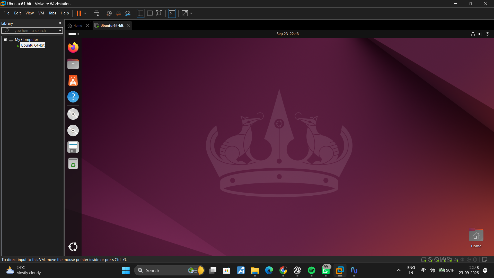 | **VMware Workstation Guest Active**<br/>Ubuntu desktop running inside VMware Workstation. | [`02-vmware-vm-running.png`](docs/screenshots/type2-vmware/02-vmware-vm-running.png) |
| 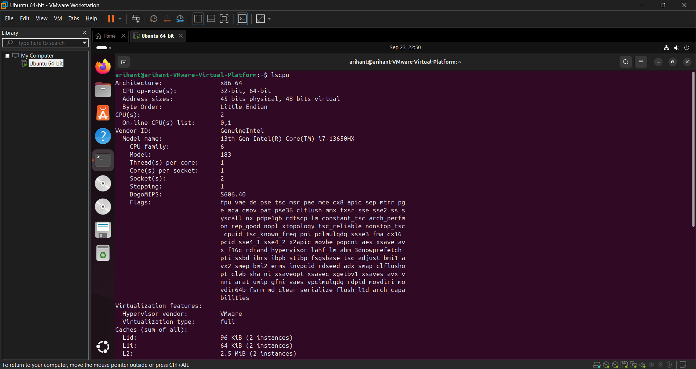 | **CPU Topology Verification (`lscpu`)**<br/>2 vCPUs verified in guest environment. | [`03-vmware-lscpu--01--.png`](docs/screenshots/type2-vmware/03-vmware-lscpu--01--.png) |
| 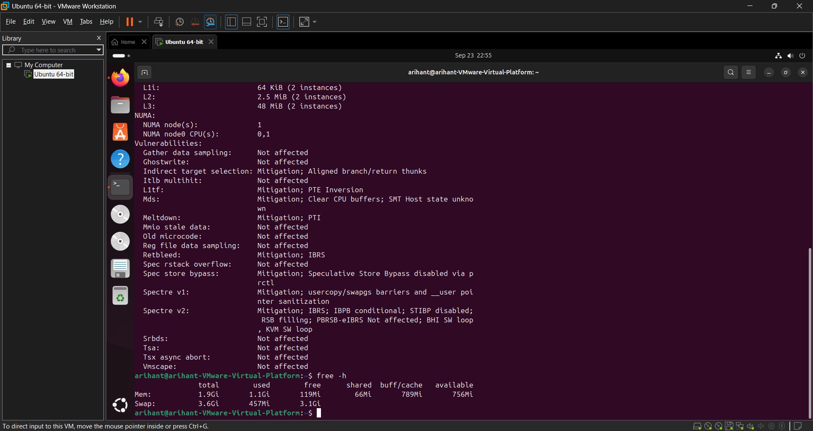 | **Memory Allocation Verification (`free -h`)**<br/>2.0 GB memory verified in guest terminal. | [`04-vmware-memory.png`](docs/screenshots/type2-vmware/04-vmware-memory.png) |
| 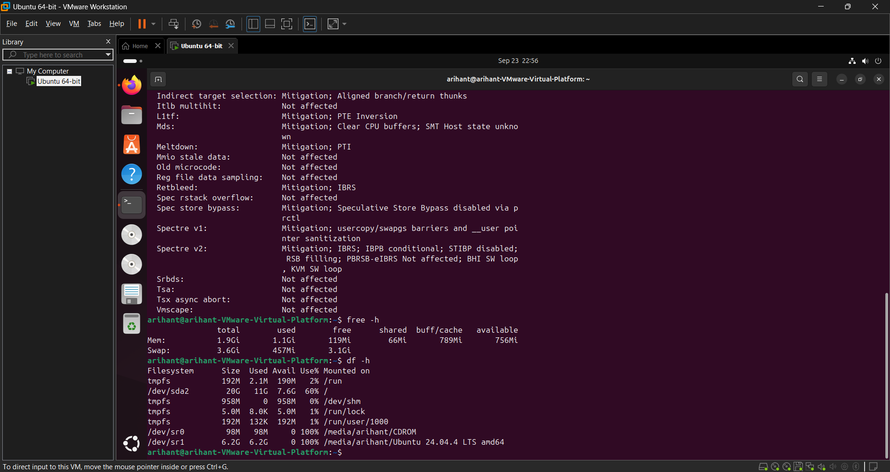 | **Filesystem Verification (`df -h`)**<br/>20 GB virtual disk partition mounted on `/`. | [`05-vmware-disk.png`](docs/screenshots/type2-vmware/05-vmware-disk.png) |
| 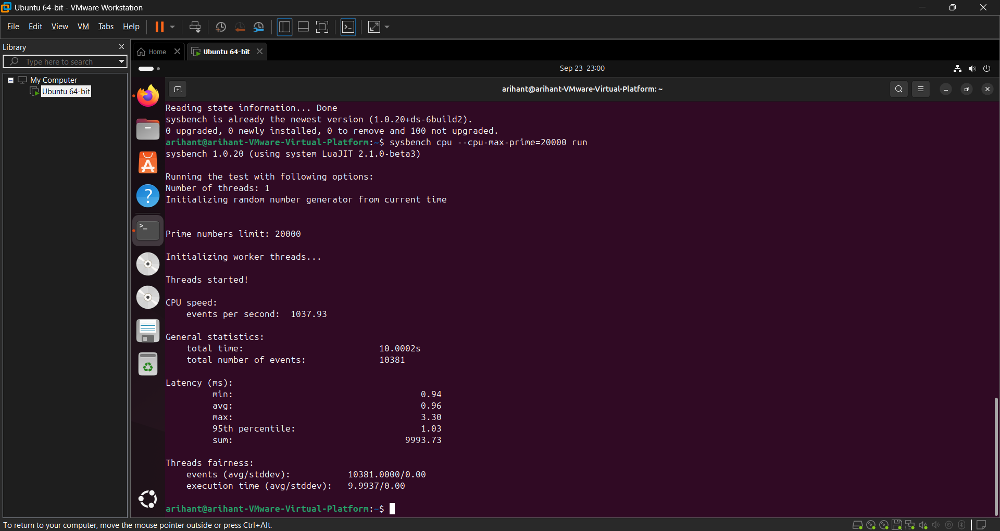 | **Sysbench CPU Benchmark Terminal Output**<br/>Primary run: 1037.93 eps, 10.0002 s, 0.96 ms avg latency. | [`06-vmware-sysbench-cpu.png`](docs/screenshots/type2-vmware/06-vmware-sysbench-cpu.png) |
| 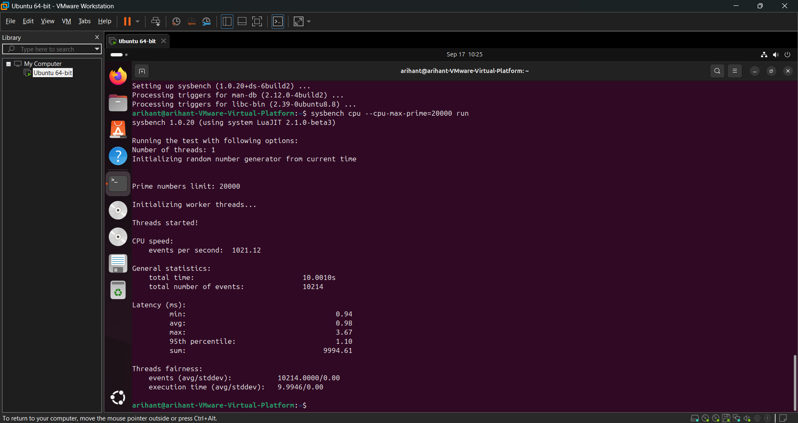 | **Secondary Verification Run**<br/>Secondary run evidence: 1021.12 eps, 10.0010 s, 0.98 ms avg latency. | [`Type2_Sysbench_CPU_Benchmark.png`](docs/screenshots/type2-vmware/Type2_Sysbench_CPU_Benchmark.png) |

---

### Comparison

The visual comparison of measured performance between Type-1 and Type-2 environments:


---

## Analysis

The empirical measurements demonstrate a quantifiable difference in computational throughput and latency between the two virtualization platforms:

### 1. Throughput Differential
During the standardized 10-second sampling window, Proxmox VE completed **14,548 events** compared to **10,381 events** on VMware Workstation. This translates to an event throughput of **1,453.98 events/sec** versus **1,037.93 events/sec**, representing a **+40.08% throughput advantage** for the Type-1 environment:
$$\Delta \text{Throughput} = \frac{1453.98 - 1037.93}{1037.93} \times 100\% = +40.08\%$$

### 2. Latency and Scheduling Responsiveness
The average latency per benchmark event was **0.69 ms** on Proxmox VE compared to **0.96 ms** on VMware Workstation, reflecting a **28.13% latency reduction**:
$$\text{Latency Reduction} = \frac{0.96 - 0.69}{0.96} \times 100\% = 28.13\%$$

Furthermore, tail latency analysis reveals that the 95th percentile latency was **0.74 ms** on Proxmox VE versus **1.03 ms** on VMware Workstation. The maximum latency recorded on VMware Workstation was **3.30 ms** compared to **1.24 ms** on Proxmox VE. The higher maximum latency under VMware Workstation indicates occasional scheduling interruptions by the host operating system.

### 3. Context & Objective Scope
> [!NOTE]
> These measurements **do not claim** that Proxmox VE is universally superior in every scenario or across different hardware generations. Rather, they demonstrate that for this specific compute-intensive, CPU-bound workload running under comparable VM resource limits, the bare-metal architecture reduced context-switching overhead and yielded superior throughput and lower latency.

---

## Observations

The following technical observations were drawn from the experiment:

1. **Execution Time Invariance**: Both benchmark runs completed in approximately 10 seconds ($10.0030\text{ s}$ vs. $10.0002\text{ s}$), confirming that Sysbench adheres to its intended duration window across both platforms.
2. **Total Events Disparity**: Despite running for the same duration, Proxmox VE processed **4,167 additional prime-search events** ($+40.08\%$).
3. **Throughput Scaling**: The throughput metric directly correlates with event completion capacity, showing that KVM's direct kernel dispatch allows more CPU cycles to reach guest compute instructions.
4. **Tail Jitter in Type-2 Architecture**: The maximum latency spike of $3.30\text{ ms}$ on VMware Workstation (compared to $1.24\text{ ms}$ on Proxmox VE) highlights the presence of background host thread scheduling and VM Exit mediation latency.
5. **Architectural Confirmation**: The empirical findings align with the theoretical model of Type-1 versus Type-2 virtualization: eliminating the intermediate general-purpose host OS reduces instruction path length and virtualization overhead.

---

## Limitations

To maintain academic and scientific rigor, the following experimental limitations must be noted:

- **Single Workload Evaluation**: Only a CPU compute-bound prime calculation benchmark was evaluated. Memory bandwidth, storage I/O, network throughput, and virtualization-aware workloads may exhibit different performance characteristics.
- **CPU-Centric Measurement**: Memory paging, dirty-page tracking, virtual disk I/O, and bridge network latency were not part of this specific benchmark test.
- **Host Hardware Influences**: Results depend on the physical hardware specifications, CPU microarchitecture, and host background processes present during testing.
- **Configuration Scope**: A single VM sizing configuration (2 vCPU, 2 GB RAM) cannot represent all enterprise multi-tenant cloud workloads.
- **Statistical Sample Size**: While repeatability was confirmed via a secondary verification run, a larger series of continuous trials would provide tighter confidence intervals and formal standard deviation bounds.

---

## Reproduction

To reproduce this benchmark experiment in your own virtualized environment, follow the steps below:

### 1. Virtual Machine Setup
Deploy an Ubuntu Linux virtual machine (64-bit) in each hypervisor with:
- **vCPU:** 2 Cores
- **RAM:** 2048 MB (2 GB)
- **Virtual Disk:** 20 GB

### 2. Verify System Configuration
Log into the Ubuntu virtual machine terminal and verify virtual resources:
```bash
# Verify CPU topology
lscpu

# Verify RAM allocation
free -h

# Verify disk partition
df -h /
```

### 3. Install Sysbench
```bash
# Update package repositories
sudo apt update

# Install Sysbench benchmark utility
sudo apt install sysbench -y

# Verify installed version
sysbench --version
```

### 4. Execute Benchmark
Run the CPU prime benchmark test:
```bash
sysbench cpu --cpu-max-prime=20000 run
```

Alternatively, use the automated benchmark script provided in this repository:
```bash
bash scripts/benchmark.sh
```

### 5. Parse and Analyze Results
Extract structured metrics and calculate comparative differentials:
```bash
# Parse Sysbench terminal output logs
python scripts/parse_sysbench.py

# Calculate comparative percentage differences and export JSON summary
python scripts/analyze_results.py

# Re-generate performance visualization plots
python scripts/generate_plots.py
```

---

## Repository Structure

```text
virtualization-performance-analysis/
├── README.md                                   # Flagship project documentation and summary
├── .gitignore                                  # Git ignore specifications
├── LICENSE                                     # MIT License
│
├── docs/
│   ├── architecture/
│   │   └── virtualization-architecture.png     # Rendered virtualization architectural diagram
│   │
│   ├── methodology/
│   │   └── methodology.md                      # Detailed experimental and scientific methodology
│   │
│   ├── screenshots/
│   │   ├── type1-proxmox/                      # Verified Proxmox VE screenshots
│   │   │   ├── 01-proxmox-dashboard.png
│   │   │   ├── 02-proxmox-vm-configuration.png
│   │   │   ├── 03-proxmox-vm-running.png
│   │   │   ├── 04-proxmox-ubuntu-console.png
│   │   │   ├── 05-01-proxmox-system-configuration.png
│   │   │   ├── 05-02-proxmox-system-configuration.png
│   │   │   ├── 06-proxmox-sysbench-result.png
│   │   │   ├── 07-01proxmox-resource-monitoring.png
│   │   │   ├── 07-02proxmox-resource-monitoring.png
│   │   │   ├── 07-03proxmox-resource-monitoring.png
│   │   │   └── 07-04proxmox-resource-monitoring.png
│   │   │
│   │   ├── type2-vmware/                       # Verified VMware Workstation screenshots
│   │   │   ├── 01-vmware-vm-configuration.png
│   │   │   ├── 02-vmware-vm-running.png
│   │   │   ├── 03-vmware-lscpu--01--.png
│   │   │   ├── 03-vmware-lscpu--02--.png
│   │   │   ├── 04-vmware-memory.png
│   │   │   ├── 05-vmware-disk.png
│   │   │   ├── 06-vmware-sysbench-cpu.png
│   │   │   └── Type2_Sysbench_CPU_Benchmark.png
│   │   │
│   │   └── comparison/                         # Comparison visualization assets
│   │       ├── events-per-second-comparison.png
│   │       ├── latency-comparison.png
│   │       ├── total-events-comparison.png
│   │       └── hypervisor-performance-comparison.png
│   │
│   └── experiment-notes/
│       └── experiment-notes.md                 # Execution logs and environment notes
│
├── type1-proxmox/
│   ├── system-info/
│   │   └── system-config.md                    # Proxmox node and VM specifications
│   ├── benchmarks/
│   │   └── sysbench-run.md                     # Sysbench run instructions
│   └── results/
│       └── proxmox-results.md                  # Detailed Type-1 measurements & transcript
│
├── type2-vmware/
│   ├── system-info/
│   │   └── system-config.md                    # VMware VM hardware settings & host relation
│   ├── benchmarks/
│   │   └── sysbench-run.md                     # Sysbench run instructions
│   └── results/
│       └── vmware-results.md                   # Detailed Type-2 measurements & transcript
│
├── results/
│   ├── raw/
│   │   ├── sysbench_results.csv                # Raw empirical measurements dataset
│   │   ├── proxmox_sysbench_output.txt         # Transcribed terminal output from Proxmox
│   │   └── vmware_sysbench_output.txt          # Transcribed terminal output from VMware
│   ├── processed/
│   │   └── performance_summary.json            # Parsed metrics and calculated deltas
│   ├── tables/
│   │   └── comparison-table.md                 # Full Markdown comparison tables
│   └── figures/
│       ├── events-per-second-comparison.png    # Throughput bar chart
│       ├── latency-comparison.png              # Latency bar chart
│       ├── total-events-comparison.png         # Total events processed chart
│       └── hypervisor-performance-comparison.png # 4-panel comprehensive dashboard
│
├── scripts/
│   ├── benchmark.sh                            # Bash automation script for Sysbench execution
│   ├── parse_sysbench.py                       # Python regex parser for Sysbench terminal logs
│   ├── analyze_results.py                      # Python engine for comparative metrics & JSON export
│   ├── generate_plots.py                       # Matplotlib visualization generator
│   └── generate_architecture_diagram.py        # Architecture diagram renderer
│
└── report/
    └── README.md                               # Academic laboratory investigation report
```

---

## Future Work

Potential extensions for future virtualization performance research include:

- **Multiple Benchmark Repetitions**: Executing 30+ iterative trials to compute 95% statistical confidence intervals and variance analysis.
- **Memory Bandwidth Evaluation**: Benchmarking memory read/write throughput using `sysbench memory` and `STREAM`.
- **Storage I/O Evaluation**: Benchmarking sequential and random disk I/O under varying queue depths using `fio` and `sysbench fileio`.
- **Virtual Network Throughput**: Measuring inter-VM and external network throughput and latency using `iperf3`.
- **Multi-Thread CPU Scaling**: Evaluating performance scalability across 1, 2, 4, 8, and 16 vCPU configurations.
- **Virtualization Overhead Analysis**: Profiling VM Exit rates, page table translations (EPT/NPT), and hypervisor context switches using Linux `perf` and KVM tracepoints.
- **Controlled Host Loading**: Measuring performance degradation under deliberate background host resource contention.

---

## Author

**Arihant Narayankar**  
*Cloud Computing / Virtualization Performance Analysis*  
- **GitHub:** [@Arihant-57](https://github.com/Arihant-57)  
- **Project Repository:** [virtualization-performance-analysis](https://github.com/Arihant-57/virtualization-performance-analysis)
