# Experimental Methodology

This document outlines the experimental framework, configuration controls, and scientific methodology used to evaluate the computational performance of **Type-1 (Bare-Metal)** and **Type-2 (Hosted)** hypervisors.

---

## 1. Experimental Objective & Research Question

### Objective
To empirically evaluate and compare the CPU execution characteristics, throughput, and scheduling latency of an identical Linux guest workload running under:
1. **Type-1 Hypervisor:** Proxmox Virtual Environment (PVE) leveraging the Linux Kernel-based Virtual Machine (KVM).
2. **Type-2 Hypervisor:** VMware Workstation running on a general-purpose host operating system.

### Research Question
> *How does CPU benchmark performance differ between a Type-1 hypervisor environment and a Type-2 hypervisor environment when comparable virtual machine resources and identical workloads are evaluated under controlled laboratory conditions?*

---

## 2. Architectural Framework

```mermaid
flowchart TD
    subgraph Type1 ["Type-1 Bare-Metal (Proxmox VE / KVM)"]
        H1["Physical Server Hardware"] --> KVM["Proxmox VE Kernel / KVM Hypervisor"]
        KVM --> VM1["Ubuntu Virtual Machine (2 vCPU, 2GB RAM)"]
        VM1 --> SB1["Sysbench CPU Benchmark (20k Primes)"]
    end

    subgraph Type2 ["Type-2 Hosted (VMware Workstation)"]
        H2["Physical Hardware"] --> HOSTOS["Host Operating System Kernel"]
        HOSTOS --> VMW["VMware Workstation Application"]
        VMW --> VM2["Ubuntu Virtual Machine (2 vCPU, 2GB RAM)"]
        VM2 --> SB2["Sysbench CPU Benchmark (20k Primes)"]
    end
```



### Type-1: Proxmox VE / KVM
- **Classification:** Bare-metal native hypervisor.
- **Operating Model:** Proxmox VE turns the Linux kernel directly into a hypervisor via the KVM kernel module. Guest virtual machines execute code directly on the host CPU using hardware virtualization extensions (Intel VT-x / AMD-V).
- **Execution Path:** The guest operating system's privileged CPU instructions are intercepted directly by the hypervisor kernel module with minimal abstraction penalty.

### Type-2: VMware Workstation
- **Classification:** Hosted hypervisor application.
- **Operating Model:** VMware Workstation operates as an application on top of an existing host operating system. 
- **Execution Path:** Guest instructions and I/O requests must traverse both the VMware virtualization monitor and the underlying host operating system's kernel scheduler and device driver stack before reaching physical silicon, introducing an additional layer of execution latency and context switching.

---

## 3. Virtual Machine Resource Normalization

To ensure an equitable baseline comparison, virtual hardware allocations were strictly standardized across both environments:

| Parameter | Type-1 (Proxmox VE) | Type-2 (VMware Workstation) | Control Rationale |
| :--- | :--- | :--- | :--- |
| **Guest Operating System** | Ubuntu Linux 64-bit | Ubuntu Linux 64-bit | Eliminates userland and kernel variance |
| **Virtual CPUs (vCPU)** | 2 Cores | 2 Cores | Identical parallel execution capacity |
| **Memory Allocation (RAM)** | 2.00 GB | 2.00 GB | Identical physical page constraints |
| **Virtual Disk Capacity** | 20.0 GB | 20.0 GB | Standardized baseline storage layout |
| **Benchmark Tool** | Sysbench 1.0.20 | Sysbench 1.0.20 | Identical testing binary and LuaJIT engine |
| **Computational Target** | 20,000 Primes | 20,000 Primes | Identical algorithmic workload |

System configurations inside the guest VMs were audited and verified using standard Linux inspection utilities:
```bash
lscpu     # CPU architecture and topology
free -h   # Memory layout and swap allocation
df -h /   # Filesystem capacity and mount points
```

---

## 4. Benchmark Workload: Sysbench CPU

### Workload Mechanics
The Sysbench CPU test evaluates processor performance by calculating prime numbers using trial division up to a specified upper bound (`--cpu-max-prime`):
```bash
sysbench cpu --cpu-max-prime=20000 run
```

Each benchmark "event" consists of computing all prime numbers up to $20,000$. The benchmark runs for a fixed duration of approximately 10 seconds, recording the number of completed iterations and the latency of each event.

### Evaluated Quantitative Metrics
1. **Total Execution Time ($T$)**: The duration in seconds of the active benchmark window ($T \approx 10.0\text{ s}$).
2. **Total Completed Events ($E$)**: The aggregate number of full prime-calculation sequences completed during the test interval.
3. **Throughput (Events per Second - $\text{EPS}$)**:
   $$\text{EPS} = \frac{E}{T}$$
4. **Latency Metrics ($L$)**:
   - **Minimum Latency ($L_{\min}$)**: The fastest completed event in milliseconds.
   - **Average Latency ($L_{\text{avg}}$)**: The arithmetic mean duration per event in milliseconds:
     $$L_{\text{avg}} = \frac{\sum_{i=1}^{E} L_i}{E}$$
   - **95th Percentile Latency ($L_{p95}$)**: The response threshold below which $95\%$ of all executed events completed.
   - **Maximum Latency ($L_{\max}$)**: The longest single event duration, indicating hypervisor scheduling interruptions.

---

## 5. Experimental Integrity & Repeatability Guidelines

1. **No Data Fabrication**: Every documented measurement reflects an actual recorded run confirmed by terminal transcripts and photographic console evidence.
2. **Single Independent Variable**: Only the virtualization hypervisor layer differs between the tested platforms; guest OS versions, CPU core counts, and RAM allocations are matched.
3. **Controlled Background Load**: External workloads and unrelated background processes on the hypervisor host nodes were minimized during data acquisition.
