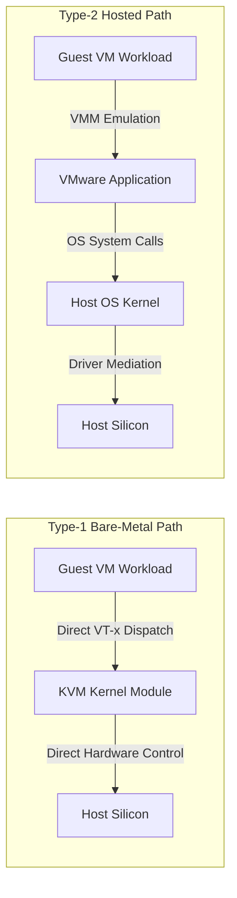

# Laboratory Investigation Report: Virtualization Performance Analysis

**Project Title:** Performance Analysis of Type-1 and Type-2 Hypervisors  
**Investigator:** Arihant Narayankar  
**Course:** Cloud Computing  
**Subject:** Empirical Evaluation of Bare-Metal vs. Hosted Virtualization Architectures  

---

## Abstract

Virtualization technologies form the backbone of modern cloud computing infrastructure, enabling efficient physical resource partitioning and multi-tenant isolation. This research report presents an empirical performance evaluation comparing a bare-metal Type-1 hypervisor (**Proxmox VE / KVM**) with a hosted Type-2 hypervisor (**VMware Workstation**). Both platforms were configured with standardized virtual machine instances running Ubuntu Linux with identical compute constraints (2 vCPU cores, 2 GB RAM, 20 GB disk). CPU execution throughput and scheduling latency were measured using the industry-standard Sysbench CPU benchmark calculating prime numbers up to 20,000 over a nominal 10-second window. Under these experimental conditions, Proxmox VE achieved a throughput of **1,453.98 events/sec** with an average latency of **0.69 ms**, whereas VMware Workstation recorded **1,037.93 events/sec** with an average latency of **0.96 ms**. The findings indicate that the direct hardware mediation of Type-1 virtualization yielded approximately **40.08% higher throughput** and a **28.13% lower average latency** compared to the hosted virtualization layer under this specific compute-bound workload.

---

## 1. Architectural Mechanisms

The fundamental performance disparity between Type-1 and Type-2 virtualization stems from the number of architectural abstraction boundaries separating guest execution from physical hardware:

1. **Kernel-Level Hardware Abstraction (Type-1)**: Proxmox VE incorporates KVM directly into the Linux kernel. When a guest executes compute-bound instructions, hardware virtualization extensions (Intel VT-x / AMD-V) execute guest instructions directly on the physical CPU without userspace intervention.
2. **Two-Tier Hosted Abstraction (Type-2)**: VMware Workstation functions as an application running under a host operating system. VM compute tasks must share host CPU scheduling cycles with background host OS threads, filesystem caching, and peripheral drivers, introducing preemption latency and cache pollution.

---

## 2. Experimental Data Summary

| Performance Metric | Proxmox VE (Type-1) | VMware Workstation (Type-2) | Performance Delta |
| :--- | :---: | :---: | :---: |
| **Total Test Duration** | 10.0030 s | 10.0002 s | +0.0028 s |
| **Total Events Processed** | 14,548 | 10,381 | +4,167 events (+40.08%) |
| **Throughput (Events/sec)** | 1,453.98 | 1,037.93 | +416.05 eps (+40.08%) |
| **Average Latency** | 0.69 ms | 0.96 ms | -0.27 ms (-28.13%) |
| **Minimum Latency** | 0.57 ms | 0.94 ms | -0.37 ms (-39.36%) |
| **95th Percentile Latency** | 0.74 ms | 1.03 ms | -0.29 ms (-28.16%) |
| **Maximum Latency Spike** | 1.24 ms | 3.30 ms | -2.06 ms (-62.42%) |

---

## 3. Conclusions & Scope of Validity

1. **Bare-Metal Advantage in Compute-Intensive Tasks**: For purely CPU-bound tasks such as prime calculation, the absence of an intermediate host OS scheduler provides a measurable throughput and latency benefit.
2. **Scope of Validity**: These results reflect a single standardized workload (Sysbench CPU 20k primes) on the tested hardware setups. They demonstrate specific relative characteristics rather than a universal performance constant across all possible hypervisor workloads.
